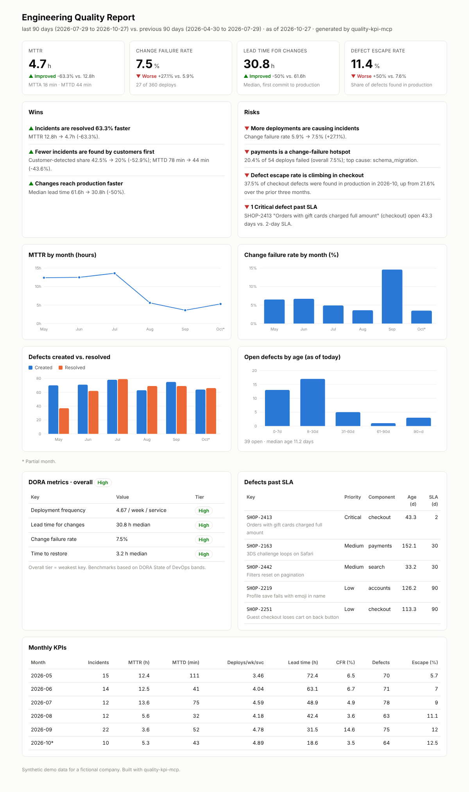
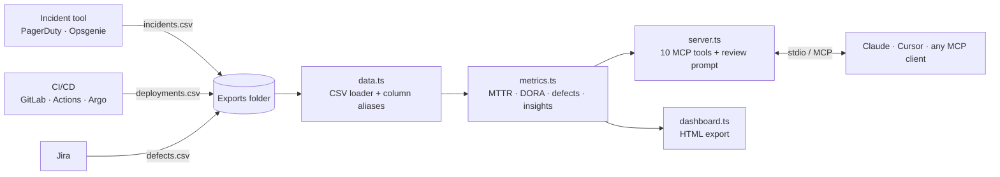

# quality-kpi-mcp

**Engineering quality KPIs for leadership, on demand: MTTR, DORA metrics, defect escape rate and SLA breaches, answered by your AI assistant from the exports you already have.**

`quality-kpi-mcp` is a [Model Context Protocol](https://modelcontextprotocol.io) server that turns incident, deployment and Jira bug exports into the numbers engineering leaders get asked for every month:

> *"What's our MTTR this quarter, and is it getting better?"*
> *"Where do we stand on DORA metrics?"*
> *"Which service is causing the most failed deploys?"*
> *"Write the monthly quality update for the exec team."*

No BI project, no data warehouse, no spreadsheet stitched together the night before the QBR. Drop in three CSV exports, and Claude or Cursor does the analysis.

## Demo

**1. "Prepare the quality update for my VP"** · Claude pulls 90 days of KPIs and writes the executive report.
https://github.com/user-attachments/assets/48914ab8-c7f4-4081-9755-02f63e99c92b

**2. Root cause and trends** · Which service is causing failed deploys, and how MTTR moved month by month.

https://github.com/user-attachments/assets/0b181d09-d29e-4b58-9811-3e5595275f67

**3. The leadership dashboard** · The HTML report the server exports, top to bottom.

https://github.com/user-attachments/assets/91b2f695-6ea3-46a5-9039-7f0d8287c968



---

## Why this exists

Every quarter I've watched engineering managers spend days assembling the same report: pull incidents from PagerDuty, deploys from CI, bugs from Jira, paste into a spreadsheet, compute MTTR by hand, then write the story. The numbers are always a week stale, and nobody trusts how they were calculated. This server makes the calculation consistent, explainable and instant.

It's the leadership companion to [qa-metrics-mcp](https://github.com/Misfit1982/qa-metrics-mcp), which handles test-level triage for engineers.

## What it measures

| Tool | What it answers |
|---|---|
| `list_data_sources` | What data is loaded, the date range, services, and the as-of date |
| `get_mttr` | **MTTR, MTTA, MTTD**: mean, median and p90, by severity, service, month or root cause, plus % of incidents customers found first |
| `get_dora_metrics` | The **four DORA keys** with an Elite / High / Medium / Low tier for each and overall |
| `get_change_failure_breakdown` | Which services' deploys cause incidents or rollbacks, the root causes, and **hotspots** |
| `get_defect_metrics` | **Defect escape rate**, escape rate by component, reopen rate, resolution time and **SLA compliance** by priority |
| `get_defect_aging` | Open defects by age, and every defect **past SLA**, worst first |
| `get_kpi_trend` | Month-by-month series for any KPI |
| `compare_periods` | Every KPI, this period vs. last, with % change and improved / worse / flat |
| `generate_executive_summary` | A one-page markdown report: bottom line, scorecard, DORA tiers, wins, risks and **recommended asks** |
| `export_leadership_dashboard` | A self-contained HTML dashboard (light and dark mode) |

Plus a **`monthly_quality_review` prompt** that chains the tools into a VP-ready monthly update.

### How the numbers are calculated

| KPI | Definition |
|---|---|
| MTTR | Mean time from incident start to resolved |
| MTTA | Mean time from detection to first acknowledgement |
| MTTD | Mean time from incident start to detection |
| Deployment frequency | Production deploys per week, per service |
| Lead time for changes | Median time from first commit to production deploy |
| Change failure rate | Share of deploys that were rolled back or caused an incident |
| Time to restore (DORA) | Median restore time for incidents caused by a deploy |
| Defect escape rate | Share of defects first found in production |
| SLA breach | Open defect older than its priority's SLA (Critical 2d, High 7d, Medium 30d, Low 90d) |

DORA tiers use benchmark bands based on the DORA State of DevOps reports (elite: on-demand deploys, lead time under a day, recovery under an hour). The overall tier is the weakest of the four keys. Bands and SLA policy are constants in `src/metrics.ts`, so you can set your own targets.

### What leaders get that a dashboard doesn't

- **Findings, not just charts.** Rule-based insights call out what changed and why it matters: *"payments is a change-failure hotspot: 20% of 54 deploys failed; top cause: schema migration."*
- **Asks, not just risks.** The executive summary ends with concrete next steps an owner can take.
- **Any period, any comparison.** `last_30_days`, `this_quarter`, `2026-09`, or any date range, always compared with a sensible baseline.

## Works with your existing exports

The loader reads CSV and recognizes common column names from real tools, so most exports work without editing:

| File | Typical source | Key columns (aliases accepted) |
|---|---|---|
| `incidents.csv` | PagerDuty, Opsgenie, incident.io, Jira Service Management | `started_at`, `detected_at`, `acknowledged_at`, `resolved_at`, `severity`/`priority`, `service`, `caused_by_deploy` |
| `deployments.csv` | GitLab CI, GitHub Actions, Jenkins, Argo CD | `deployed_at`, `first_commit_at`, `service`, `environment`, `status` |
| `defects.csv` | Jira bug export | `key`, `priority`, `component`, `found_in`, `created`, `resolved`, `status` |

Priorities like *Highest / Blocker / P1* map to Critical, *SEV1 / P1 / critical* map to SEV1, and *prod / live* maps to production. Non-production deploys are ignored. Files are re-read on every call, so dropping in a fresh export updates every answer.

## Quick start

```bash
git clone https://github.com/Misfit1982/quality-kpi-mcp.git
cd quality-kpi-mcp
npm install          # also compiles TypeScript to dist/
npm run smoke        # end-to-end test over real MCP stdio
```

The repo ships with six months of synthetic data for a fictional e-commerce company, with real stories planted in it (see [Sample data](#sample-data)).

### Connect to Claude Desktop

Add to `claude_desktop_config.json`:

```json
{
  "mcpServers": {
    "quality-kpi": {
      "command": "node",
      "args": ["/absolute/path/to/quality-kpi-mcp/dist/server.js"],
      "env": { "KPI_DATA_DIR": "/absolute/path/to/your/exports" }
    }
  }
}
```

### Connect to Claude Code

```bash
claude mcp add quality-kpi -- node /absolute/path/to/quality-kpi-mcp/dist/server.js
```

### Connect to Cursor

Add the same block to `.cursor/mcp.json`.

### Configuration

| Variable | Default | Purpose |
|---|---|---|
| `KPI_DATA_DIR` | `./sample-data` | Folder with `incidents.csv`, `deployments.csv`, `defects.csv` |
| `KPI_OUTPUT_DIR` | `./output` | Where the dashboard is written |
| `KPI_AS_OF` | latest date in the data | "Today" for all calculations, e.g. `2026-10-27` |

## Example session

> **You:** Prepare the quality update for my VP. Last 90 days.
>
> **Claude:** *(calls `generate_executive_summary`, `get_change_failure_breakdown`, `get_defect_aging`)*
>
> **Bottom line:** Delivery is rated High on all four DORA keys. Incident recovery improved sharply: MTTR fell 63% to 4.7 hours. Two things need attention: deploy quality on payments and bugs escaping in checkout.
>
> **Wins**
> - MTTR 12.8h → 4.7h after the on-call runbooks rollout
> - Customers now find 20% of incidents first, down from 43%
> - Lead time for changes halved to 31 hours
>
> **Risks and asks**
> 1. **payments:** 20% of deploys failed, mostly schema migrations. *Ask: require tested rollback plans for migrations.*
> 2. **checkout:** 38% of October's defects were found in production. *Ask: add regression coverage before the next release.*
> 3. **SHOP-2413** (gift-card orders charged full amount) has been open 43 days against a 2-day SLA. *Ask: named owner and fix date this week.*

Full generated output: [`docs/sample-executive-summary.md`](docs/sample-executive-summary.md).

## Sample data

Six months (May to October 2026) of synthetic data for a fictional company, ShopLite: about 660 production deploys, 85 incidents and 420 Jira bugs. Planted storylines the tools should find:

1. MTTR drops sharply after on-call runbooks roll out on Aug 1
2. Customer-reported incidents fall after synthetic monitoring goes live, so MTTD drops
3. The payments service's change failure rate spikes in September (a risky schema migration)
4. Defect escape rate climbs in the checkout component
5. A Critical checkout defect sits open for 40+ days, far past its 2-day SLA
6. Lead time for changes improves steadily as PRs get smaller

`npm run smoke` asserts that every one of them is detected.

## Architecture



```
src/
  data.ts        CSV parsing and normalization (severity, priority, environment, column aliases)
  metrics.ts     Pure KPI functions, DORA bands, SLA policy, insights, executive summary
  dashboard.ts   Self-contained HTML leadership dashboard
  server.ts      MCP server: tools, input validation (zod), error handling
scripts/
  generate-sample-data.ts   Deterministic synthetic data with planted storylines
  smoke-test.ts             End-to-end test via the official MCP client
```

## Roadmap

- Pull directly from the Jira, PagerDuty and GitLab APIs instead of CSV exports
- Per-team scorecards and targets
- Scheduled monthly report delivered to Slack or email
- Incident-to-RCA linking with the companion RCA assistant

## About

Built by **Jared Hood**, QA leader with 20 years in SaaS, fintech and media. I build AI-assisted QA and engineering-metrics tooling: MCP servers, test automation, and reporting that turns raw data into decisions.

*All data in this repo is synthetic and describes a fictional company.*

License: MIT
